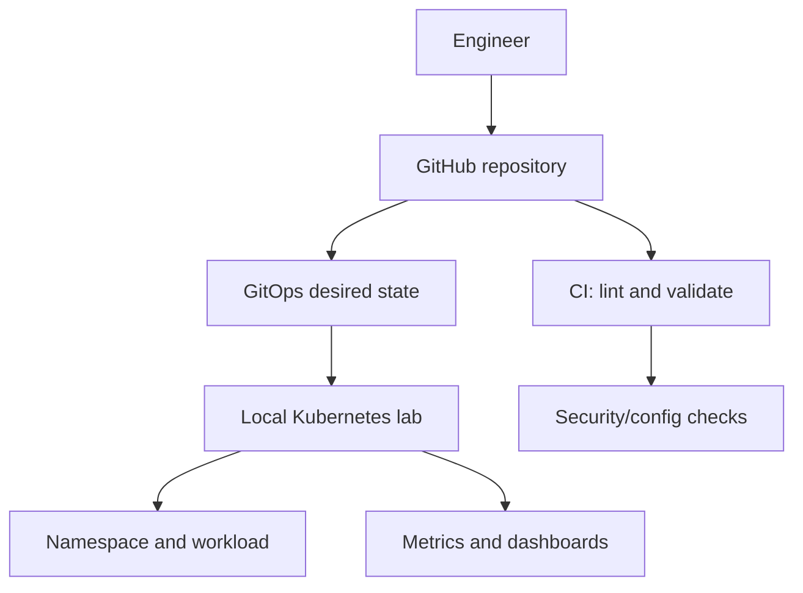
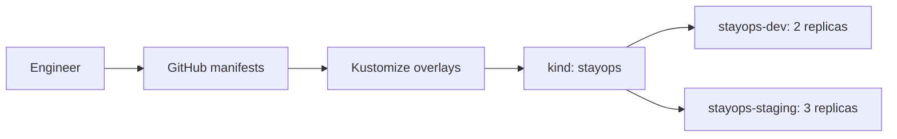

# StayOps Platform — Architecture Baseline

**Status:** initial design; components are not deployed yet.

## Scenario
StayOps is a fictional hospitality organization. The platform team provides a repeatable deployment and operations path for a representative service. Application development is out of scope; use an existing/demo container image.

## Target flow

This is a target flow, not a claim that all components exist.

## Resource and cost model
- No AWS or paid cloud subscription required.
- GitHub public repository and free CI are the starting point.
- Select local runtime only after checking host RAM, CPU, and disk.
- Keep cluster footprint small; add GitOps and observability incrementally.
- If a component cannot run locally, document/design it or validate config statically—do not claim runtime proof.

## Candidate choices
| Concern | Candidate | Decision note |
|---|---|---|
| Local cluster | kind or k3d | Choose after resource check |
| Packaging | Helm | Reusable workload configuration |
| GitOps | Argo CD | Sync and drift demonstration |
| CI | GitHub Actions | Free repository checks |
| Automation | Ansible | Idempotent host configuration |
| IaC | Terraform | Only if a valid local use case exists |
| Security | RBAC, NetworkPolicy, Trivy | Test behavior and limitations |
| Observability | Prometheus/Grafana or lighter tools | After workload baseline |

## Trust and safety
- Never commit kubeconfig, tokens, private keys, passwords, or unredacted secrets.
- Use least privilege and namespace separation.
- Pin dependency/action versions where practical.
- CI checks do not imply production certification.
- Local Kubernetes differs from OpenShift: SCC, Routes, Operators, and platform APIs need separate OpenShift evidence.

## Architecture decisions
Record context, options, decision, and consequences in `docs/architecture/decisions/`. First decisions: runtime, workload image, GitOps footprint, observability footprint.

## Current implementation baseline (2026-11-06)

- **Local lab runtime:** kind cluster `stayops` (one control-plane, two workers; Kubernetes v1.35.0 observed). See [ADR-001](decisions/ADR-001-local-kubernetes-runtime.md).
- **Workload baseline:** NGINX deployed declaratively with Kustomize base and Dev/Staging overlays; Dev has 2 replicas in `stayops-dev`, Staging has 3 in `stayops-staging`. Both Services are ClusterIP and in-cluster HTTP has been tested. See [lab evidence](../lab/nginx-service-networking.md).
- **Implemented now:** local Kubernetes, namespace separation for lab environments, Deployment/Service, Kustomize rendering and apply, rollout checks, service DNS/HTTP smoke tests.
- **Not implemented yet:** CI pipeline beyond repository validation, GitOps controller/sync, metrics/dashboards, security scanning/policy enforcement, OpenShift deployment, and production HA. These remain target architecture items.

## Current flow (implemented subset)

This is the currently validated local subset; it does not include automated CI/CD or GitOps reconciliation.
